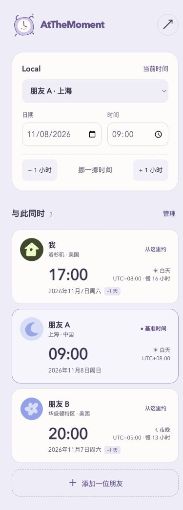

# 与此同时 · AtTheMoment

一个适合手机使用的朋友时区换算网站。无需注册，输入保存在当前浏览器。

**在线使用：** https://hiraethliug9177.github.io/AtTheMoment/

| 中文 | English | 日本語 | 한국어 |
|---|---|---|---|
| [打开](https://hiraethliug9177.github.io/AtTheMoment/) | [Open](https://hiraethliug9177.github.io/AtTheMoment/en.html) | [開く](https://hiraethliug9177.github.io/AtTheMoment/ja.html) | [열기](https://hiraethliug9177.github.io/AtTheMoment/ko.html) |



## 功能

- 为朋友添加城市、国家、姓名和头像；同一城市可添加多位朋友。
- 提供 40 张圆形头像，人数不设应用上限（受设备存储限制）。
- 任选一人作为日期与时间输入基准，自动换算所有地点的当地时间及日期。
- 使用浏览器 Intl / IANA 时区规则，考虑所选日期的夏令时，提示不存在或重复的当地时间。
- 分享工具链接，或分享包含朋友名单、地点与约定时间的链接。
- 中文、English、日本語、한국어 四语言，页面右上角切换；切换语言不会重置输入。

## 数据与隐私

朋友数据仅保存在当前浏览器的 localStorage，不会跨设备同步；清除浏览器数据会移除记录。约定链接包含姓名、地点及时间，收到链接的人可查看。

城市搜索使用 [Open-Meteo Geocoding API](https://open-meteo.com/en/docs/geocoding-api)，地点数据来源为 [GeoNames](https://www.geonames.org/)（CC BY 4.0）。只发送城市搜索词，不发送朋友姓名。时区准确性取决于设备内置规则。

## 项目文件

- `index.html`：默认入口（中文，之后记住语言选择）
- `en.html`、`ja.html`、`ko.html`：英、日、韩入口
- `style.css`：样式
- `app.js`：朋友、城市搜索、本地保存与分享
- `time.js`：时区换算
- `i18n.js`：四语言文案与语言偏好
- `logo.png`：Logo 与标签页图标
- `avatars/`：40 张头像
- `docs/screenshots/`：截图（不影响网站运行）

## 本地运行

无安装或构建依赖：

```sh
python3 -m http.server 4173
```

打开 http://localhost:4173 。

## 发布

通过 GitHub Pages 从 `main` 分支根目录发布。推送到 `main` 后网站自动更新。

## 许可

本仓库未指定开源许可证。
